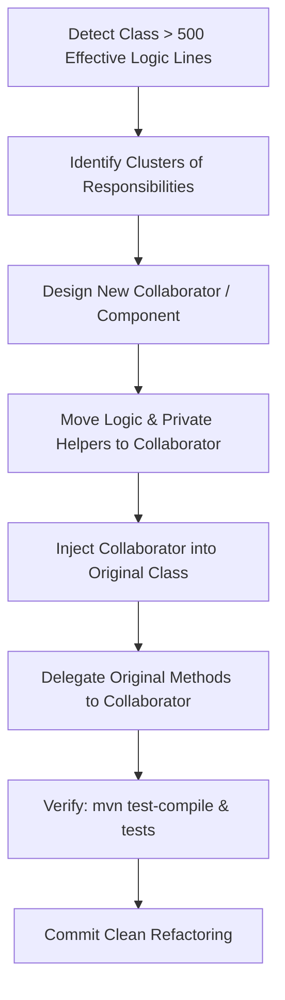

# Backend Class Size & Responsibility Refactoring Skill

This skill enforces maintainability, the Single Responsibility Principle (SRP), and clean code structure across all backend Java modules in the repository.

---

## 1. The 500-Line Effective Logic Rule

> [!IMPORTANT]
> **Trigger Condition**: When any backend Java class contains more than **500 lines of effective logic**, it **must** be refactored by extracting cohesive chunks of logic into separate, focused classes or services.

### How to Calculate "Effective Logic Lines":
The 500-line threshold measures **actual business and functional logic**, not structural ceremony:

| EXCLUDED from Line Count (Ceremony / Boilerplate) | INCLUDED in Line Count (Effective Logic) |
| :--- | :--- |
| Package & import statements | Method bodies and business algorithms |
| Class field & constant declarations (`private final ...`) | Data processing, parsing, transformation pipelines |
| Constructors (and Lombok `@RequiredArgsConstructor`, `@AllArgsConstructor`, etc.) | Complex calculations and domain rules |
| Getters & Setters (and Lombok `@Getter`, `@Setter`, `@Data`) | Orchestration, delegation, flow-control logic |
| Standard `equals`, `hashCode`, `toString` methods | Error handling, fallback mechanisms |
| Javadoc, inline comments, and blank lines | Custom validation and formatting procedures |

If the remaining method logic exceeds ~500 lines, the class is taking on too many responsibilities (a "God Class" code smell) and must be decomposed.

---

## 2. Refactoring Strategies

When decomposing an oversized class, choose one or more of the following patterns:

### Strategy 1: Delegate / Collaborator Extraction (Recommended)
Extract a cohesive subset of related methods into a new Spring `@Component` or `@Service`.
- **Example**: If a storage service manages disk persistence, tag parsing, M3U8 generation, and disk scanning:
  - Extract scanning/reconciliation into a dedicated `Scanner` / `Indexer` component (e.g. `AudioLibraryScanner`).
  - Extract file generation into a generator component (e.g. `AudioPlaylistGenerator`).
  - The main service injects the collaborators and coordinates them.

### Strategy 2: Facade & Backward Compatibility Preservation
To avoid breaking controllers or other calling services:
- Keep the original service class as a **Facade**.
- Retain existing public method signatures on the original class, but have them simply delegate to the newly extracted collaborators.
- Callers (REST controllers, listeners, other services) continue to work seamlessly without ripple effects.

### Strategy 3: Domain Action / Command Extraction
If a class performs diverse distinct actions (e.g. `importZip`, `exportZip`, `synchronizeTags`, `generateSummary`):
- Extract each complex workflow into a focused handler/command class (e.g. `ZipImportHandler`, `ZipExportHandler`).
- Inject only the dependencies that specific workflow actually needs.

### Strategy 4: Strategy Pattern for Format / Protocol Variations
If a class contains large `switch` statements or conditional branching based on types (e.g. MP3 vs FLAC vs WAV, MP4 vs HLS):
- Define an interface for the operation and create separate strategy implementations for each variation.

---

## 3. Step-by-Step Refactoring Workflow

Follow this systematic process whenever refactoring an oversized class:

### Step 1: Cluster Analysis
Group the private helper methods and public methods by their operational focus. Look for:
- Groups of private methods that only call each other and manipulate a subset of state.
- Methods dealing with external data conversion or file formats.
- Methods performing background maintenance, scanning, or batch imports.

### Step 2: Extract Collaborator Class
1. Create a new class (e.g. `[Domain][Responsibility]Service.java` or `[Domain][Responsibility]Helper.java`).
2. Mark it as `@Service` or `@Component` if it requires Spring dependency injection.
3. Move the relevant state, dependencies, and methods into it.
4. Keep method visibility appropriate (`public` for methods called by the coordinator, `private` for internal helpers).

### Step 3: Wire & Delegate
1. Inject the new collaborator into the original class via constructor injection.
2. Replace the extracted code in the original class with concise delegation calls.
3. Ensure `@Transactional` boundaries and thread-safety invariants (`synchronized`, locks) remain intact at the appropriate boundary.

### Step 4: Verification & Compilation
1. Run `mvn test-compile -pl <module>` to verify syntax and dependency wiring.
2. Run relevant unit and integration tests to ensure behavior is identical.

---

## 4. Concurrency & Transaction Safeguards

When moving methods between classes:
1. **Thread-Safety**: If methods in the original class were `synchronized` on `this`, extracting them to a collaborator means they will synchronize on the collaborator instance, not the parent. If state is shared, either:
   - Synchronize on an explicit shared lock object passed to both, or
   - Ensure the collaborator is stateless or encapsulates its own concurrent state (e.g. `ConcurrentHashMap`).
2. **Spring Transactions (`@Transactional`)**:
   - Calls within the same class bypass Spring AOP proxies (self-invocation problem).
   - Moving `@Transactional` methods to a separate collaborator enables Spring proxying, which is usually desirable. Ensure transaction propagation settings (`REQUIRED`, etc.) match intent.

---

## 5. Refactoring Checklist

Before finalizing any refactoring:
- [ ] Original class effective logic reduced significantly below 500 lines.
- [ ] Each extracted class has a single, clearly identifiable responsibility.
- [ ] Public API contracts preserved via delegation where backward compatibility is needed.
- [ ] Constructor injection used for all new Spring dependencies (no `@Autowired` field injection).
- [ ] No circular dependencies introduced between collaborators.
- [ ] Documentation, docstrings, and comments preserved.
- [ ] Code compiles cleanly (`mvn test-compile`) with zero regressions.
